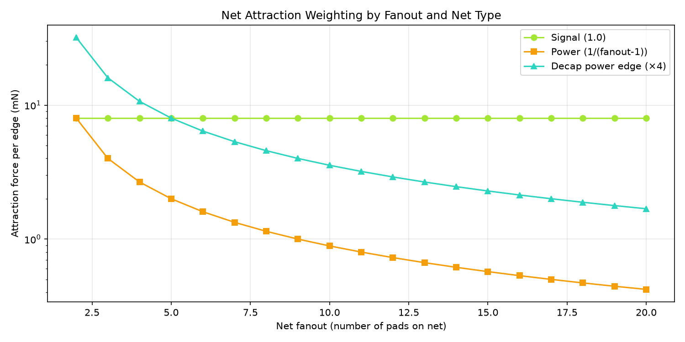
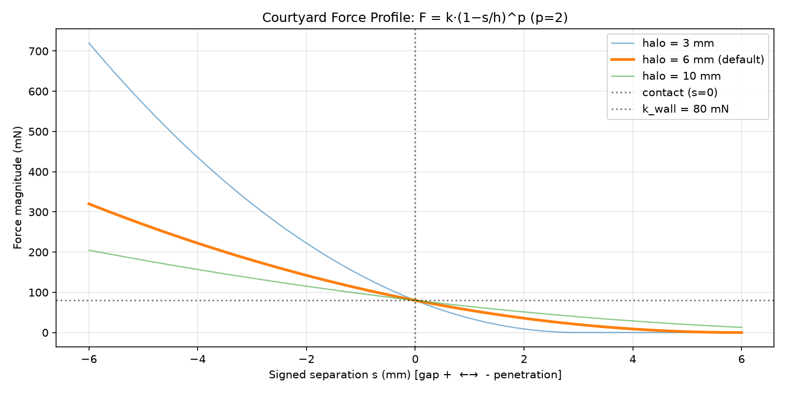
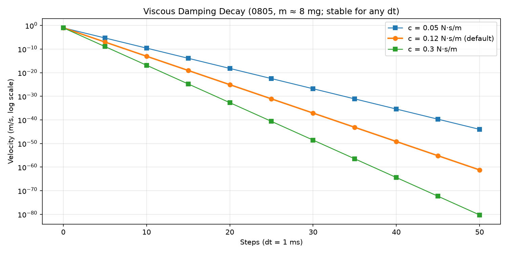
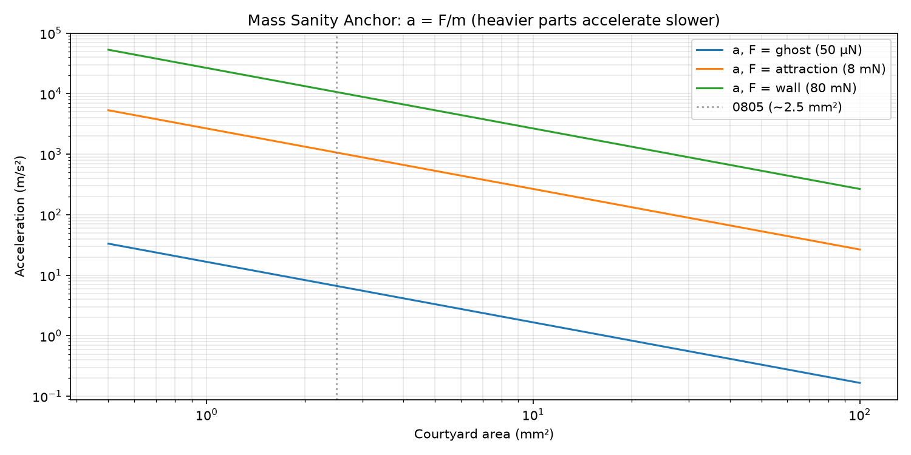

# Physics Primer: SI Placement Dynamics

This document explains the force-spring physics engine that drives component placement in KiCad AutoRouter. It is **not a general physics tutorial** — it is a reference for our specific implementation: the formulas we use, the parameters that control them, and how to interpret the visual output.

All quantities in the solver are SI: **meters** for geometry, **newtons** for force, **kilograms** for mass, **seconds** for time. Board files and SVG output remain in millimeters at the boundaries; conversion happens at ingest/report.

> **Normative reference**: `docs/si_force_laws.md` is the source of truth for formulas. This primer adds visualizations and parameter-response graphs to build intuition.

---

## 1. Force Laws Overview

The net force on each pad is the sum of five independent causes:

$$\mathbf{F}_{\text{total}} = \mathbf{F}_{\text{repulsion}} + \mathbf{F}_{\text{attraction}} + \mathbf{F}_{\text{courtyard}} + \mathbf{F}_{\text{ghost}} + \mathbf{F}_{\text{tangential}}$$

Each cause has a distinct role and color in the SVG force overlay:

| Cause | Color | Role | Key Parameters |
|-------|-------|------|----------------|
| **Repulsion** | Cyan `#22d3ee` | Pad-to-pad Coulomb push ($k_{\text{rep}}/d^2$) | `repulsion_k_N_m2` |
| **Attraction** | Lime `#a3e635` | Net springs pulling connected pads together | `attraction_k_N` |
| **Courtyard** | Pink `#f472b6` | Collision response (SAT minimum-translation axis), plus the board wall (region polygon as inverted courtyard) | `wall_k_N`, `wall_halo_m` |
| **Ghost** | Lavender `#c4b5fd` (dotted) | Pulls target parts toward ghost anchors | `ghost_k_N` |
| **Tangential** | Yellow `#eab308` | Sliding assist along contact (MTV-perp), γ fraction of normal force in direction of relative tangential motion | `contact_tangent_gamma` |

## 2. Pad Repulsion (Coulomb-like)

**Formula** (from `si_force_laws.md` §1):

$$\mathbf{F}_{\text{rep}}(i \leftarrow j) = k_{\text{rep}} \frac{\hat{\mathbf{u}}(i - j)}{d^2}$$

where $d$ is the pad-to-pad distance in **meters**, $k_{\text{rep}}$ has units $\text{N}\cdot\text{m}^2$, and $\hat{\mathbf{u}}$ is the unit vector from $j$ to $i$.

**Key insight**: This is a *pairwise* force evaluated at the **pad level**, not footprint level. A footprint with 4 pads feels 4× the repulsion from a neighbor's 4 pads (16 pair interactions).

The equilibrium distance for an isolated pad pair (repulsion vs. attraction) is:

$$d_{\text{eq}} = \sqrt{\frac{k_{\text{rep}}}{k_{\text{attr}}}}$$

{#fig-repulsion-vs-distance}

**Parameter tradeoff**:

- **Higher `repulsion_k_N_m2`** → pads push harder at a given distance → larger equilibrium spacing → parts spread out more aggressively
- **Lower `repulsion_k_N_m2`** → weaker push → attraction dominates → parts cluster tighter, but risk courtyard overlap if `wall_k_N` isn't strong enough

The default `2e-9` places equilibrium at ~0.5 mm for default attraction — repulsion only matters *inside* contact range; the courtyard wall owns the contact response.

---

## 3. Net Attraction (Constant-Magnitude Springs)

**Formula**:

$$\mathbf{F}_{\text{attr}} = k_{\text{attr}} \cdot w_{\text{edge}} \cdot \hat{\mathbf{u}}(\text{src} \to \text{dst})$$

- $k_{\text{attr}}$ in newtons (default `8e-3` N = 8 mN)
- $w_{\text{edge}}$ is a dimensionless weight per net edge:
  - Signal nets: `1.0`
  - Power nets: `power_attraction_scale / (fanout - 1)` — fans out the pull so a rail shared by many parts doesn't collapse them
  - Decoupling caps (C*, 2 pads, one power + one GND): additional `decap_boost` multiplier (default `4×`)
  - GND nets: **excluded** (pours connect anywhere) — *except* decap GND-side edges

{#fig-attraction-fanout}

**Parameter tradeoff**:

- **Higher `attraction_k_N`** → stronger pull → tighter clustering, faster convergence, but more overlap pressure on courtyards
- **`power_attraction_scale`** — turn down (< 1) to weaken rail pull; turn off (`include_power_nets: false`) to exclude power entirely
- **`decap_boost`** — increase to anchor decoupling caps more aggressively to their power/GND rails

---

## 4. Courtyard Collision (SAT + Halo)

This is the most complex force. It uses **Separating Axis Theorem (SAT)** for analytical collision on rectangles/circles (80% of pairs), falling back to shapely for polygons.

### 4.1 Unified Contact Law (Overlap + Halo)

Courtyards use **one law** in signed separation `s` (gap positive,
penetration negative) — the formula never changes at intersection:

$$F_{\text{wall}} = k_{\text{wall}} \left(1 - \frac{s}{\text{halo}}\right)^p$$

with exponent $p = $ `wall_exponent` (default 2.0; $p > 1$ softens the halo
approach and stiffens deep penetration; $p < 1$ is rejected by validation —
singular at the halo edge). Contact stays C0/C1-continuous for any $p \ge 1$.

- Zero past the halo reach, $k_{\text{wall}}$ at contact, growing with
  penetration depth — C0 and C1 continuous at first touch
- Depth comes from SAT (rectangles/circles) or vertex-projection interval
  overlap (generic polygons); no intersection areas anywhere
- Direction = **minimum-translation vector (MTV)** from SAT — pushes parts apart along the *shortest* escape axis, never centroid-to-centroid
- This prevents "small part tucked under large courtyard" tunneling bugs

### 4.2 Near-Miss Halo

The halo is the same law at `s > 0` (`wall_halo_m` = 6 mm engine/Cluster
default; the Legalize preset uses 4 mm): force falls from $k_{\text{wall}}$
at contact to 0 at the halo edge following the chosen exponent. One scale
serves approach and penetration.

### 4.3 Per-Pair Aggregation (Critical!)

One footprint pair may have **multiple collision sub-paths**: body courtyard + THT pin circles on both layers. Without aggregation, pin circles stack the same contact 3–9×.

**Aggregation rule** (per footprint pair): every sub-path reports a signed
separation in mm; the single deepest contact wins (winner-takes-all), and
its magnitude is the unified law above. No area summation, so stacked
sub-contacts cannot inflate one pair's penalty.

{#fig-courtyard-force-profile}

**Parameter tradeoff**:

| Parameter | Effect | Typical Range |
|-----------|--------|---------------|
| `wall_k_N` | Overall collision stiffness. Higher = harder push-out at contact | 0.02–0.1 N |
| `wall_halo_m` | Single distance scale: halo reach AND penetration stiffness. Larger = earlier gentle push, softer deep response | 0.003–0.01 m |
| `wall_exponent` | Shape of the law. 1.0 = linear; higher softens approach, stiffens deep overlap | 1.0–3.0 |

All response graphs are generated from the engine's live defaults with
`python scripts/plot_force_laws.py --outdir docs/figures`
(`fig_wall_profile.png` and `fig_wall_exponent.png` cover the wall law).

**Heatmap: Overlap resolution vs. wall_k_N and damping**

{#fig-overlap-resolution-heatmap}

---

## 5. Board Wall (Region Edge)

There is no separate boundary law: the board region polygon is an
**inverted courtyard** evaluated with the same wall law
$F = k(1-s/h)^p$ from §4. Inside the outline the signed separation is
the gap to the region boundary (halo pull-off, $k$ at touch);
straddling the edge it is minus the protrusion depth (growing
push-out); fully outside — or inside a cutout — it is a bounded
pull-home at contact strength. Cutouts act as walls for free, since
the distance is measured to the full region boundary (outer ring +
holes). Containment stiffness is `wall_k_N`: under 25x repulsion gain
a corner pile-up can rest ~2mm over the line, while production gain
seats parts fully inside.

**Key insight**: one law, two roles — a neighbour's courtyard pushes
parts apart, the board's inverted courtyard pushes them inside. There
is no boundary knob to tune against the wall.

---

## 6. Ghost Attraction

The first five sections covered the forces parts exert on each other. The
last four pieces are the stagehands: invisible helpers (§6), shock absorbers
(§7), the stepper's safety nets (§8), and part weights (§9).

Ghosts are invisible stagehands you place yourself: a **wall** that shoves
parts out of a keepout region, or an **attractor** that drags a named part
somewhere it should go (a connector to the board edge, say). You build them
in the UI Ghosts panel — wall vs attractor, plus the `ka` strength box.

**Formula** (from `si_force_laws.md` §1):

```
F_ghost = k_ghost · ka · û(target→anchor)
```

A ghost is a fixed anchor that participates in placement but never moves and
never becomes copper: a **wall** (courtyard-only obstacle, pushes parts away
via the normal wall law, no attraction springs) or an **attractor** (pulls
named target refs). The anchor is the ghost footprint's position; the pull is
split equally over the target's pads; there is no reaction force on the ghost
(infinite mass). `ka` is the dimensionless per-spring weight from the file
`(property "ghost_attract_N" "TARGET,ka")` (`ghost.make_ghost_attractor`).

**Scale reading**: `ghost_k_N = 50 µN` by default (**untouched by calibration**)
against `attraction_k_N = 8 mN` — the ghost pull is ~1/160th of a net spring
at unit weight. The UI offers `ka = 0.1` out of the box (5 µN effective):
a nudge-scale effect, not a room-scale one. The response below is linear
because the law is constant-magnitude — no distance falloff, unlike a Hooke
spring — so reaching attraction-scale pull needs `ka ≈ 160`.

**Figure: pull-in distance vs. ka** (solver sweep: one 6×4 mm part, ghost
anchor 20 mm away, all other forces off, 500 iterations):

{#fig-ghost-pullin}

**Key insight**: weak pulls also crawl for a second reason — a lone
constant force accelerating from rest trips the adaptive-dt guard (§8) down
to its floor, so the run spends its whole budget at 0.05 ms steps. Terminal
velocity still scales with `F`, which is why the curve stays linear, but
budget your iterations (or your `ka`) accordingly.

**Parameter tradeoff**:

| Parameter | Effect | Typical Range |
|-----------|--------|---------------|
| `ghost_k_N` | Global ghost spring scale. Higher = every ghost pulls harder; still split per-pad with no reaction | 50 µN default (untuned); raise order-of-magnitude for room-scale pulls |
| `ka` (per spring) | File/UI weight on one ghost→target spring. The knob you actually turn — it lives in the Ghosts panel attractor row | 0.1 (UI default nudge) to ~160 (attraction-scale) |

---

## 6.5 Tangential Assist (Sliding Along Contacts)

Parts pressed against long walls or neighbors at an angle rub left-right each
step instead of settling: the wall normal pushes straight in, and anything
perpendicular to that axis is noise. The tangential assist adds a small force
along the contact tangent (MTV-perp axis) proportional to the contact normal
force, so a part already sliding keeps sliding in the same direction — it
settles flat against the wall instead of wedging.

**Formula** (from `si_force_laws.md` §1):

```
F_t = γ · |F_n| · sign(v_rel_t)
```

- `γ = contact_tangent_gamma` (default 0.15) — fraction of the contact normal force applied along the tangent axis
- `v_rel_t` = relative tangential velocity between the two footprints, averaged over pads along the MTV-perp axis
- `sign` is **latched per contact pair**: once decisive motion sets a slide direction, near-zero noise keeps it — a part pressed at an angle slides one way and settles, instead of flip-flopping each step

Applied at the contact point via contact-weighted pad spread, so differential pad loading becomes torque through Kabsch rigid projection: a rectangular part pressed at an angle to a long wall slides and rotates until its long edge lays flat against the wall, then stops.

**Parameter tradeoff**:

| Parameter | Effect | Typical Range |
|-----------|--------|---------------|
| `contact_tangent_gamma` | Fraction of contact normal force applied tangentially (0 = disabled) | 0.1–0.3 typical; 0.15 default (legalize regime) |

**Why a latch?** A bare `sign(v_rel_t)` flips at near-zero velocity: tiny noise makes the part rub left-right each step and never settle. Holding the sign through near-zero noise (threshold `1e-9` m/s) lets sustained pushes converge to one direction. First contact defaults to +1, matching the historical behavior.

---

## 7. Damping and Friction

If forces are the engine, damping is the shock absorbers and friction is the
parking brake: damping keeps parts from ringing around their targets, and
friction makes them actually stop once they arrive. Both live under Advanced
in the placement panel.

**Formulas** (from `si_force_laws.md` §1):

```
F_damp = −c · v                        c = damping_Ns_m in N·s/m
freeze whole footprint if max pad ‖F‖ < friction_N
```

Damping is one clean linear knob applied per pad, folded into the
integrator as an implicit-Euler decay `v *= 1/(1 + c·dt/m)` — stable for any
timestep, unlike an explicit drag that blows up when `c·dt/m > 2`. Friction
is the dry deadband with all-or-nothing rigid semantics: when every pad of a
footprint feels less than `friction_N = 1 µN`, the whole body freezes for
that step (and loses its velocity). It stops micro-motion in force units —
no displacement hack — and it is what terminates the long Coulomb-tail
cruises: a tail that stays above the deadband cruises past any iteration
budget, so `friction_N` must be scaled to the tail strength (`kr`).

**Figure: viscous decay envelopes** (analytic, live defaults — an 0805,
`m ≈ 8 mg`, kicked at 0.1 m/s):

{#fig-damping-decay}

**Key insight**: damping and friction split the job — damping shapes the
approach (no ringing), friction decides the stop. If converged boards still
drift, the deadband is below the tail: raise `friction_N`, not the damping.

**Parameter tradeoff**:

| Parameter | Effect | Typical Range |
|-----------|--------|---------------|
| `damping_Ns_m` | Approach speed vs overshoot (Advanced → Damping). Legalize 0.12–0.15, cluster 0.08 | 0.05–0.3 N·s/m |
| `friction_N` | Deadband floor (Advanced → Friction deadband). Too low = endless micro-cruise; too high = parts freeze short of equilibrium | ~1 µN default |

---

## 8. Integrator and Guards

The engine moves the board in 1 ms hops, with three safety nets underneath:
a speed limit, a rotation clamp, and steps that shrink themselves when things
get violent. You rarely touch these directly — the Cluster/Legalize regime
presets set them for you — but this section explains what keeps a run from
flying apart. (`dt`/`vmax` live under Advanced if you ever need them.)

**Update rule** (from `si_force_laws.md` §2), per movable pad per iteration:

```
v += (F / m) · dt        # kick (a = F/m in m/s²)
v *= 1 / (1 + c·dt / m)  # implicit-Euler viscous decay (stable for any dt)
if ‖v‖·dt > vmax:  v *= vmax / (‖v‖·dt)   # speed ceiling, replaces max_step_mm
x += v · dt              # drift
```

Then the Kabsch snap — the math that keeps each part rigid — fits each body's
pads back onto its exact shape, and velocity is **re-derived** from the actual
projected displacement (`v := (x_proj − x_old)/dt`), so the projection can't
inject phantom energy.
Two guards sit on top:

- **Rigid-step clamp** (tunneling guard): the velocity ceiling alone cannot
  bound rotation — a Kabsch snap can swing pads past `vmax·dt` (observed: a
  7 mm leap against a 3 mm cap, −40° spins). After projection, each body's
  centroid shift is clamped to `vmax·dt` and its rotation to 5°/step,
  re-posed rigidly; re-derivation runs after the clamp. Sub-0.1°/step
  rotation creep is dropped by an angular noise floor, but genuine slow
  torque still turns parts (observed: an 0805 flipping ~160° toward its rail
  over 400 iters — a compass-needle response, kept deliberately).
- **Adaptive-dt guard** (convergence safety net): tracks system kinetic
  energy; halves `dt` when it rises iteration-over-iteration, regrows ×1.1
  when it falls, floored at `dt_min_s = 0.05 ms`, capped at `dt_max_s = 2 ms`.
  The halve/regrow asymmetry ratchets `dt` to the floor under sustained
  acceleration — e.g. a lone constant force spinning up from rest (see §6) —
  where tiny steps fake slow progress while forces stay large. The floor
  exists so oscillation can't fake convergence, not so runs live there:
  `PlacementParams` validates `dt_min_s ≤ dt_s ≤ dt_max_s`.

**Figure: one-step drift vs. dt** (analytic, live defaults — an 0805 from
rest; drift is `min(v·dt, vmax·dt)`):

{#fig-integrator-stability}

**Key insight**: at the default 1 ms step, attraction-scale drift (~1 mm)
sits right at the `vmax·dt` ceiling and wall-scale forces are deep into it —
the ceiling, not `dt`, sets the pace of violent steps. Raise `dt` past the
guard band and steps start skipping over contacts (tunneling risk even with
the clamp); drop below it and runs burn budget inside the friction deadband.

**Parameter tradeoff**:

| Parameter | Effect | Typical Range |
|-----------|--------|---------------|
| `dt_s` | Step size. Larger = faster but coarser; the guard adapts downward under instability | 1 ms default (legalize), 2 ms cluster |
| `vmax_m_s` | Speed ceiling + rigid-step clamp scale. Higher = faster, less stable | 1.0 m/s default |
| `dt_min_s` / `dt_max_s` | Guard rails, not knobs. Floor stops fake convergence; ceiling keeps dense steps accurate | 0.05 ms / 2 ms |

---

## 9. Mass Model

Heavy parts are lazy and light parts are skittish: mass only sets the *pace*
of placement, never the *destination* (equilibrium comes from the force
balance). To teach the engine your library's weights, add rows to
`data/footprint_mass.json` — everything unlisted just weighs its courtyard.

**Formula** (from `si_force_laws.md` §4):

```
m = mass_density_kg_m2 · courtyard_area_m² + mass_floor_kg,  clamped ≥ floor
```

`data/footprint_mass.json` maps exact `footprint_id` → keyword substring →
area fallback: known parts get table masses, everything else weighs its
courtyard at `3.0 kg/m²` plus a `1e-9 kg` floor so division by `m` is always
safe. Ghost pads inherit table/fallback mass too (harmless — immovable pads
never integrate; it only keeps `F/m` finite).

**Figure: acceleration vs. courtyard area** (analytic, live defaults):

{#fig-mass-acceleration}

**Key insight**: mass only sets the *pace*, never the *destination* —
equilibrium positions come from the force balance, so a wrong mass table
slows convergence but doesn't move the answer. Calibrate it last.

**Parameter tradeoff**:

| Parameter | Effect | Typical Range |
|-----------|--------|---------------|
| `mass_density_kg_m2` | Area slope for unknown parts. Higher = big parts lazier | 3.0 kg/m² default |
| `mass_floor_kg` | Division-by-zero guard, doubles as minimum part mass | 1e-9 kg (not a knob) |