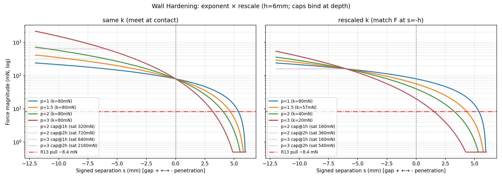
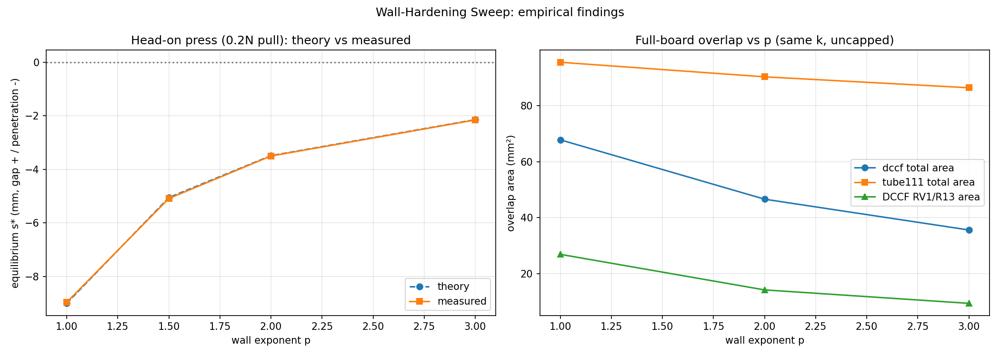

# Wall-Hardening Sweep: exponent × force scale × deep cap

Question: should the courtyard wall go nonlinear (`wall_exponent` p > 1),
rescaled, and/or depth-capped — so locked courtyards evict intruders at
shallower depths? No locked-vs-unlocked stiffness split: all parts are
equally hard. Data + graphs below; landing recommendation at the end.

- Sweep script: `scripts/sweep_wall_hardening.py`
  (renders this JSON + the findings figure; `--plot-only` regens figures).
- Raw data: `docs/benchmarks/wall_hardening_2026-10-17.json` (44 cells:
  24 press + 13 DCCF + 4 tube111 + 3 magnet; magnet overlap threshold
  0.01 mm², board threshold 1.0 mm²).
- Law curves: `docs/figures/fig_wall_exponent_rescaled.png`
  (`plot_force_laws.py --only wall_exponent_rescaled`).
- Empirical curves: `docs/figures/fig_wall_sweep_findings.png`.
- Hardware: all runtimes measured on a 2022 Apple M2 chip.

## Setup

- **Rescale rule** (fair comparison across p): match F at one-halo
  penetration, `k(p) = 2·k0/2^p` (k0 = 80 mN). Curves meet at contact by
  construction; the rescale isolates shape from magnitude.
- **Cap** (`wall_cap_depth_mm`, 0 = off): evaluated depth clamped to
  `s >= -cap`, so force saturates at `k·(1+cap/h)^p` instead of running
  away (p=3 at two-halo depth is 27× contact otherwise).
- **Theory** (corrected during the sweep — the first pass used the linear
  halo formula for all p): halo branch `s = h·(1−(F/k)^(1/p))`, penetration
  branch `pen = h·((F/k)^(1/p)−1)`, pass-through when `F` exceeds the
  (possibly capped) saturation force.

## 1. Head-on press probe (analytic ground truth)

Mover reeled into a locked wall by a single known pull (ka = 0.05 / 0.2 N),
equilibrium separation measured vs theory (mm, gap + / penetration −):

| p | ka=0.05: meas vs pred | ka=0.2: meas vs pred |
|---|---|---|
| 1.0 | +2.28 vs +2.25 | −8.96 vs −9.00 |
| 1.5 | +1.65 vs +1.61 | −5.09 vs −5.05 |
| 2.0 | +1.25 vs +1.26 | −3.50 vs −3.49 |
| 3.0 | +0.90 vs +0.87 | −2.15 vs −2.14 |

All within ~0.05 mm: the loop implements the law exactly, through the
full integrator (damping, projection, adaptive dt). Cap semantics check:
p=1/cap@1h vs 0.2 N pull (saturation 160 mN < 200 mN) pushes clean THROUGH
as predicted; cap@2h (240 mN) holds. Every other cap cell is identical to
uncapped — caps only bind past the tested depths.

Two-regime behavior to keep in mind:

- **Sub-k pulls rest CLOSER with p** (halo softening): an 8.4 mN pull
  balances at +5.4 mm (p=1) → +4.1 mm (p=2) → +3.2 mm (p=3). Still
  overlap-free, but the halo margin shrinks.
- **Super-k pulls bury SHALLOWER with p** (−9.0 → −3.5 → −2.1 mm at
  0.2 N): this is the hardening the sweep was asked for.

## 2. Full DCCF @200 iters (the real trap board)

| preset | p / k | pairs>1mm² | total mm² | RV1/R13 | max rot |
|---|---|---|---|---|---|
| defaults | 1 same-k (status quo) | 9 | 67.8 | 26.9 | 3.5° |
| defaults | 2 same-k | 10 | 46.6 (−31%) | 14.2 | 3.6° |
| defaults | 2 rescaled (k=40mN) | 10 | 54.9 | 13.3 | 2.7° |
| defaults | 3 same-k | 9 | **35.6 (−47%)** | 9.4 | 3.3° |
| defaults | 3 rescaled (k=20mN) | 10 | 56.6 | 8.7 | 2.6° |
| defaults | 2/3 same-k + cap@1h | = uncapped | = uncapped | = | = |
| legalize | 1 (status quo) | 10 | 67.5 | 27.2 | 3.5° |
| legalize | 2 same-k | 9 | 43.9 | 14.0 | 3.6° |
| legalize | 3 same-k | 10 | 36.2 | 9.2 | 3.3° |

(`same-k` at p=1 duplicates bit-identically — determinism check, not a bug.
Pair families are unchanged; depths shrink. Caps never bind: max
penetrations stay < 1 halo on these boards.)

Rescaled-k trades total area for wedge depth: the softened halo lets
non-wedged pairs rest closer (more cross the 1 mm² line) while the worst
wedge gets marginally shallower. Same-k dominates on totals at every p.

## 3. Sanity: tube111 + magnet scatter

- tube111 @200: p=1 → 25 pairs / 95.5 mm² / 105°; p=2 → 22 / 90.3 / 92°;
  p=3 → 20 / 86.4 / 92.7°. Monotonic improvement, no new spin family
  (baseline already compass-needles past 100°).
- Magnet scatter, Cluster preset (ka=0.05, wall=0.025): spread 33.2 →
  13.8 (p=1, 1 sliver 0.7 mm²) → 4.7 (p=2, zero overlap) → 4.5 (p=3,
  zero overlap). Nonlinear walls cluster tighter AND cleaner — the
  softened halo lets groups close ranks while deep stiffness keeps them
  off each other. Rotation comparable (120–150° in all cells; scatter
  spins at baseline too).
- Stability: all 41 cells finite, no NaN/blowup, honest `budget` stops
  with residuals attached; runtimes unchanged within noise.

## 4. Dropped: synthetic R13/RV1 trap probe

Hand-built trap rigs (locked RV1 + resistor + 3-vs-2 anchors + southern
squeeze block) escape around the span ends at every p (0 overlap,
11–14 mm travel, ~165° compass spin) instead of reproducing DCCF's trap,
which needs the exact neighbor field + net topology. Kept out of the
record rather than tuned until it traps — the press probe carries the
analytic signal, full DCCF carries the trap signal.

## Recommendation (decision open — defaults NOT flipped)

1. **`wall_exponent` default 1.0 → 2.0, same k.** Best
   risk-adjusted cell: −31% DCCF, −6% tube111, cleaner clustering, halo
   resting gaps stay ≥4 mm at R13-scale pulls, deep force bounded at 9×
   contact in the plotted range. p=3 wins bigger (−47%) but rests
   sub-k pulls at ~3 mm and pushes 27× tails — keep as the documented
   next step after dt-floor/damping behavior at p=3 gets its own look.
2. **Land `wall_cap_depth_mm` (new param, default 0 = off for now).**
   Semantics proven (through-case + no-op cases); measured boards never
   reach cap depths, so any default is insurance only. Candidate: 12 mm
   (2 halos) once p=2 lands — bounds the 9× tail with zero measured
   behavior change.
3. **Do not rescale k with p.** Rescaled-k loses on totals everywhere
   measured; the contact-anchored same-k comparison is both simpler and
   better.
4. **Before landing:** Cluster-regime full check is done (magnet cells
   above — clean); remaining is your go/no-go on this document.

Caveat that survives hardening: where attraction wins at *every* exit,
the wedge persists, only shallower (RV1/R13 26.9 → 14.2 → 9.4, never 0).
Eliminating that family needs anchor-side work (edge-count/topology),
not stiffer walls — tracked separately.
